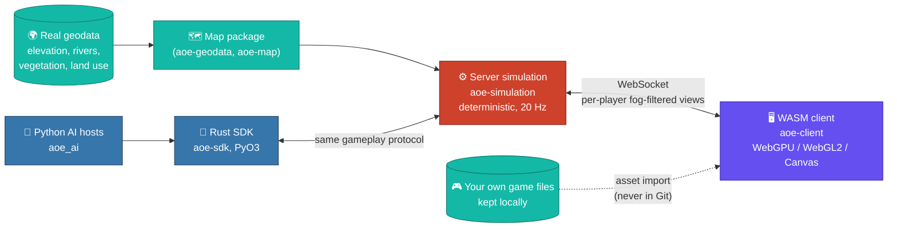
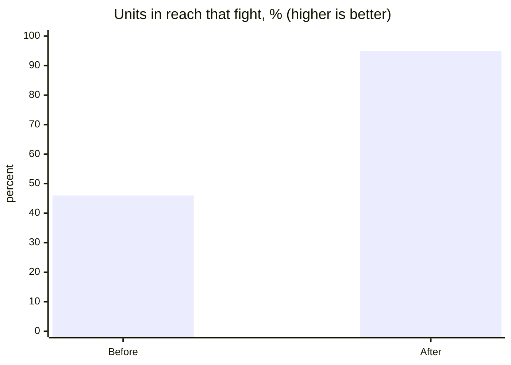

<div align="center">

# 🏰 AoeWorld

### An Age of Empires II–style RTS in your browser, played on the real world

*Server-authoritative Rust simulation, WebGPU client, maps built from real geodata, and up to 100 players driven by Python AIs.*


[Quick start](#-quick-start) ·
[Features](#-features) ·
[Architecture](#-architecture) ·
[Status](#-project-status-and-roadmap) ·
[Documentation](docs/index.md)

</div>

---

{{VIDEO}}

<div align="center"><sub>🎬 Real gameplay: armies, bridges, fleets and cities on maps generated from real terrain.</sub></div>

---

## 🖼️ Gallery

<table>
  <tr>
    <td align="center"><br><sub><b>🌍 Real-world landscape</b><br>A scout explores terrain built from real elevation, rivers and vegetation</sub></td>
    <td align="center"><br><sub><b>🌉 Bridge and fishing fleet</b><br>Roads, bridges and boats working a real river</sub></td>
  </tr>
  <tr>
    <td align="center"><br><sub><b>🏘️ Castle Age town</b><br>Farms, mills, walls and towers around the Town Center</sub></td>
    <td align="center"><br><sub><b>🏙️ Imperial city</b><br>A grown city guarded by a castle</sub></td>
  </tr>
  <tr>
    <td align="center"><br><sub><b>⚔️ Armies clash</b><br>Formations meet in the open field</sub></td>
    <td align="center"><br><sub><b>🛡️ Army crosses a bridge</b><br>Long-range pathfinding on real terrain</sub></td>
  </tr>
  <tr>
    <td align="center"><br><sub><b>🗺️ Strategic far view</b><br>Icons, layers and charts when you zoom all the way out</sub></td>
    <td align="center"><br><sub><b>💥 Late-game battle</b><br>Thousands of units in one fight</sub></td>
  </tr>
  <tr>
    <td colspan="2" align="center"><br><sub><b>🔁 Armies clash, in motion</b></sub></td>
  </tr>
</table>

---

## ✨ Features

| | Area | What you get |
| :-: | --- | --- |
| 🌍 | **Real-world maps** | Terrain generated from real geodata: elevation, rivers, coasts, vegetation and historical land use. Any place: the Paris basin, the Alps, the Brittany coast, Finnish lakeland, all of France. A real progress bar shows map creation. |
| 🏛️ | **Four ages** | Dark → Feudal → Castle → Imperial, with upgrades and hidden bonuses. |
| 🌾 | **Economy** | Villagers, gathering, farms, mills, markets, drop-off points and bulk trade. |
| ⚓ | **Navy and fishing** | Docks, fishing boats, galleys, transports and auto-scout, on rivers, lakes and coasts. |
| 🧱 | **Fortifications and roads** | Walls, gates, towers, castles, bridges and roads. |
| 👑 | **Management units** | **Steward**, **Vassal** and **General** run work for you, so one human can govern a huge map. |
| ⚔️ | **Armies and formations** | Group formations, attack-move, and long-range pathfinding on real terrain. |
| 🤖 | **Python AIs** | Up to 100 players. AIs are separate Python processes using a Rust SDK (PyO3), see only what their fog of war allows and send the same orders a person can. |
| 🔭 | **Strategic far view** | Zoom out to army tokens, ownership, economy cards, threats, resources, bridges and charts. |
| 💾 | **Pause, save, resume** | Pause with `P`, save a match and resume it later. Fog of war is on. |

---

## 🧭 Architecture



### 📈 Measured: faster map preparation

Measured on a 480 km Paris map, from the commit messages of the geodata optimisations (machine load 10 to 15, wall time in seconds).

```mermaid
xychart-beta
    title "Map preparation, seconds (lower is better)"
    x-axis ["Overview fields", "Hydrology pages", "Whole worker"]
    y-axis "seconds" 0 --> 140
    bar [31, 74, 131]
    bar [8, 18, 31]
```



| Step (Large map) | Before | After |
| --- | ---: | ---: |
| Overview fields | 31 s | **8 s** |
| Hydrology pages | 74 s | **18 s** |
| Whole map worker | 131 s | **31 s** |
| Static navigation build (480 km, 6 workers) | 18 min 28 s | **118 s** |

### ⚔️ Measured: armies that actually fight

Share of units within reach of an enemy that fight, in a two-army battle probe (marching attack-move armies, from the combat commit).



<sub>Numbers come from commit messages on `dev` (#719 and the geodata and navigation commits). They are single measurements on a shared machine, not a benchmark suite.</sub>

---

## 🚀 Quick start

<details>
<summary><b>▶️ Play locally</b> (Linux x86-64, Docker)</summary>

<br>

You need Git, Make, Docker and Docker Compose. You also need your own copy of the original game files (see [Assets and licensing](#-assets-and-licensing)).

```sh
# 1. Build the pinned toolchain image and install Git hooks
make bootstrap

# 2. Prepare your local game files and convert them into a pack
#    (download and extraction steps are in docs/assets.md)
make assets-import

# 3. Start the server and client with your pack
AOE_ASSET_PACK=local-assets/packs/<pack-hash> make dev
```

Then open <http://localhost:8080/>. A pack that lacks the Definitive Edition overlay is refused with a hint to run `make assets-import-de`.

| Command | Purpose |
| --- | --- |
| `make help` | List implemented commands |
| `make status` / `make logs` | Inspect your running server |
| `make down` | Stop this checkout's server |
| `DEV_PORT=8082 make dev` | Use another host port |
| `make map-generate` | Generate a large map from geodata |

Details: [local development](docs/local-development.md), [assets](docs/assets.md), [geographic map workflow](docs/geodata/workflow.md).

</details>

<details>
<summary><b>⌨️ Controls and hotkeys</b></summary>

<br>

| Input | Action |
| --- | --- |
| Left click / drag | Select units and buildings |
| Right click | Move, gather, attack or garrison, depending on the target |
| `Ctrl` + right click | Queue up to 16 waypoints |
| Arrow keys | Pan the camera |
| `P` or `Pause` | Pause and resume |
| `Ctrl` + `0`–`9` | Assign a control group |
| `0`–`9` | Recall a control group (tap twice to centre it) |
| `Shift` + `0`–`9` | Add the selection to a group |
| `B` | Open the economic buildings menu |
| `G` | Toggle the grid |
| `Delete` | Delete the selected entities |
| `Esc` | Cancel the current order |
| `Space` | Jump to the latest alert |
| `End` | Jump to your army |
| `Ctrl` / `Shift` + `F1`–`F4` | Save / recall a camera bookmark |
| `F1`–`F6` (strategic view) | Switch layers: ownership, armies, economy, threats, resources, roads and bridges |

Hotkeys are ignored inside text fields and open dialogs. The client code in `web/navigation/` and `crates/client/` is the source of truth; [village interface](docs/village-interface.md) and [strategic view](docs/strategic-view.md) describe the panels.

</details>

---

## 👑 Management units

<details>
<summary><b>🧑‍🌾 Steward, 🛡️ Vassal and ⚔️ General explained</b></summary>

<br>

| Unit | Trained at | Role |
| --- | --- | --- |
| 🧑‍🌾 **Steward** | Town Center | Garrisoned in a Town Center, it runs the villagers in a 100-tile circle around it: resource weights, a cap and training controls. See [Steward economy](docs/economy/steward.md). |
| 🛡️ **Vassal** | Castle | Garrisoned in a Castle, it takes over a territory: defends it, recruits idle soldiers, and develops it with towers, barracks, gated walls, roads and bridges. See [economy](docs/economy.md#defensive-vassal). |
| ⚔️ **General** | Castle (Castle Age) | Leads an army of up to 100 soldiers with Captain and Trainer modes, five unit-mix sliders and a Train button that recruits from nearby production buildings. See [the General](docs/gameplay/general.md). |

AIs get the same units through the [AI SDK](docs/ai-sdk.md), so a Python bot can delegate work exactly as a human does.

</details>

---

## 🧱 Architecture and crates

<details>
<summary><b>🦀 Crates and what each does</b></summary>

<br>

| Crate / directory | Role |
| --- | --- |
| `crates/core` | Typed identifiers and coordinates |
| `crates/simulation` | Deterministic game state, spatial queries, economy, combat, navy |
| `crates/scenario` | Seeded workload definitions |
| `crates/protocol` | Wire messages and versioned protocols |
| `crates/server` | Configuration, HTTP, WebSocket lifecycle, clocks |
| `crates/client` | Browser client compiled to WASM |
| `crates/rendering` | WebGPU, WebGL2 and Canvas rendering |
| `crates/assets` | Importer for your local game files into asset packs |
| `crates/geodata` | Geodata ingestion and landscape generation |
| `crates/map` | Map packages and chunks |
| `crates/sdk` | Rust AI SDK: protocol client, fog-filtered world model, bot loop |
| `crates/sdk-python` | PyO3 / maturin Python bindings of the SDK |
| `crates/harness` | Policy and command tooling (checks, gates, shipping) |
| `ai/` | `aoe_ai` Python host and bots |
| `web/` | Page shell and interface scripts |
| `docs/` | Documentation, ADRs and measurements |

Read [architecture](docs/architecture.md), [AI SDK](docs/ai-sdk.md) and the [ADRs](docs/adr/index.md) for the design.

</details>

<details>
<summary><b>🛠️ Development and checks</b></summary>

<br>

Read [AGENTS.md](AGENTS.md) and the [engineering guide](docs/agent-engineering.md) first. All build and check targets run in Docker.

```sh
make hooks-install     # install Git hooks
make fmt-check         # formatting
make lint              # clippy
make structure-check   # file-size and directory-size limits
make docs-check        # documentation checks
make preflight         # full local gate before committing
make test-e2e          # browser suite (run for web or client changes)
```

Focused tests per crate, for example `make test-native-focused AOE_NATIVE_TEST_PACKAGE=aoe-simulation AOE_NATIVE_TEST_FILTER='test(navy::)'`. Text files stay within 500 lines and a directory holds at most 14 code or config files. See [testing](docs/testing.md), [gates](docs/gates.md) and [shipping](docs/shipping.md).

</details>

<details>
<summary><b>🚧 Project status and roadmap</b></summary>

<br>

| | Area | State |
| :-: | --- | --- |
| ✅ | Real-world maps, progress bar, minimap | Working |
| ✅ | Dark to Imperial ages, economy, farms, markets | Working |
| ✅ | Navy, fishing, bridges, walls, gates, towers, castles | Working |
| ✅ | Steward, Vassal, General | Working, still being refined |
| ✅ | Python AIs over the Rust SDK, up to 100 seats | Working |
| ✅ | Pause, save, resume, fog of war, strategic far view | Working |
| 🔧 | Group pathfinding and formations at scale on real terrain (rivers, forests, bridges) | In progress |
| 🔧 | Tick rate in huge late-game matches | In progress |
| 🧭 | Deeper Imperial Age content, full road network, more civilizations and units | Planned |

**Scale, honestly.** The goal is 100 players and 10,000+ units in real time at the server's 20 ticks per second. Today a late-game match with about 10,000 units runs near 10 ticks per second, so it is being optimised, and the synthetic workloads in `docs/scale/` are not a claim of finished RTS performance. Details: [scale](docs/scale/capacity.md), [performance](docs/performance.md).

</details>

<details>
<summary><b>🎨 Assets and licensing</b></summary>

<br>

- **Code** is MIT licensed, see [LICENSE](LICENSE).
- **Original game assets** are never in this repository or in Docker images. You supply your own files; the importer converts them into a pack under the ignored `local-assets/` directory.
- Original game data keeps its own license, separate from AoeWorld's. See [THIRD_PARTY.md](THIRD_PARTY.md) and [assets](docs/assets.md).
- Geodata sources and their handling are described in the [geographic map workflow](docs/geodata/workflow.md).

</details>

---

<div align="center">

📚 **[Documentation index](docs/index.md)** · 🧭 **[Architecture](docs/architecture.md)** · 🤖 **[AI SDK](docs/ai-sdk.md)** · 🧪 **[Testing](docs/testing.md)**

</div>
